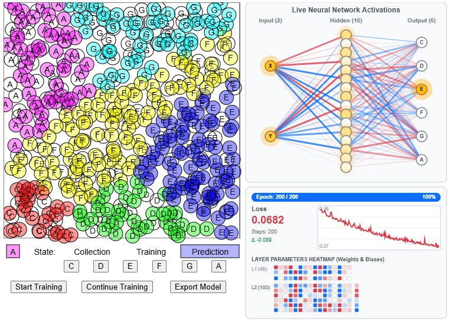

# Local examples

## Click classifier with sound

This project was created with p5js - look at the website [https://editor.p5js.org/mkreier/sketches/C6VWNya75](https://editor.p5js.org/mkreier/sketches/C6VWNya75).



```js
// Version 2026-10-27
// p5.js   v2.3.4
// ml5.js  v0.12.2
// tfjs    v1.7.4   
// https://editor.p5js.org/mkreier/full/C6VWNya75

let classifier;
let targetLabel = 'C';
let state = 'collection';
let startTime;
let changedLabel = false;
let collectedData = false;
let trained_epochs = 0;
let rx, ry;

// Visualizer global handle
let visualizer;

// --- Training Telemetry & Graph Trackers ---
let lossHistory = [];
let currentLoss = null;
let currentEpoch = 0;
let baseTrainedEpochs = 0;
let targetSessionEpochs = 200;
const INITIAL_EPOCHS = 200;

let notes = {
  C: 261.62,
  D: 293.66,
  E: 329.63,
  F: 349.23,
  G: 392.0,
  A: 440.0
};

let colors = {
  C: 'rgba(255,   0,   0, 0.4)',
  D: 'rgba(   0, 255,   0, 0.4)',
  E: 'rgba(   0,   0, 255, 0.4)',
  F: 'rgba(255, 255,   0, 0.4)',
  G: 'rgba(  0, 255, 255, 0.4)',
  A: 'rgba(255,   0, 255, 0.4)'
};

function setup() {
  console.log('Click classifier with sound v1.1')
  console.log('ml5 version:', ml5.version); // Prints: ml5 version: 0.12.2
  console.log('tfjs version:', ml5.tf ? ml5.tf.version.tfjs : 'Not exposed');
  createCanvas(760, 540);

  let options = {
    inputs: ['x', 'y'],
    outputs: ['label'],
    task: 'classification',
    debug: true
  };
  classifier = ml5.neuralNetwork(options);

  background(255);
  stroke(0);
  rect(0, 0, 400, 400);
  printState();

  // Control Buttons
  trainButton = createButton('Start Training');
  trainButton.position(20, 480);
  trainButton.mousePressed(startTraining);

  continueButton = createButton('Continue Training');
  continueButton.position(140, 480);
  continueButton.mousePressed(continueTraining);

  exportButton = createButton('Export Model');
  exportButton.position(290, 480);
  exportButton.mousePressed(saveModel);

  // Note Selection Buttons
  buttonC = createButton('C');
  buttonD = createButton('D');
  buttonE = createButton('E');
  buttonF = createButton('F');
  buttonG = createButton('G');
  buttonA = createButton('A');

  buttonC.position(110, 445);
  buttonD.position(160, 445);
  buttonE.position(210, 445);
  buttonF.position(260, 445);
  buttonG.position(310, 445);
  buttonA.position(360, 445);

  buttonC.mousePressed(noteC);
  buttonD.mousePressed(noteD);
  buttonE.mousePressed(noteE);
  buttonF.mousePressed(noteF);
  buttonG.mousePressed(noteG);
  buttonA.mousePressed(noteA);

  const layerSizes = [2, 16, 6];
  visualizer = new NetworkVisualizer(layerSizes, 410, 0, 340, 305);
  visualizer.draw();

  setupParameterDOM();
}

// Add or update the draw() function in sketch.js:
function draw() {
  // If the user's cursor is over the visualizer panel, redraw to animate particles
  if (mouseX >= 410 && mouseX <= 750 && mouseY >= 0 && mouseY <= 540) {
    refreshVisualizerAndParams();
  }
}

// Redraw visualizer when hovering over parameters for responsive tooltips
function mouseMoved() {
  if (mouseX >= 410 && mouseX <= 750 && mouseY >= 0 && mouseY <= 540) {
    refreshVisualizerAndParams();
  }
}

// Helper to pull current weights and biases out of ml5's underlying TensorFlow model
function getModelWeights() {
  try {
    let tfModel =
      classifier?.neuralNetwork?.model ||
      classifier?.model?.model ||
      classifier?.model ||
      classifier?.data?.model;

    if (!tfModel || !tfModel.layers) return null;

    let weightsPerLayer = [];
    tfModel.layers.forEach((layer) => {
      let layerWeights = layer.getWeights();
      if (layerWeights && layerWeights.length > 0) {
        let kernelMatrix = layerWeights[0].arraySync();
        let biasVector = layerWeights.length > 1 ? layerWeights[1].arraySync() : [];
        weightsPerLayer.push({
          kernel: kernelMatrix,
          bias: biasVector
        });
      }
    });

    return weightsPerLayer.length > 0 ? weightsPerLayer : null;
  } catch (err) {
    return null;
  }
}

function refreshVisualizerAndParams() {
  let weights = getModelWeights();
  visualizer.draw(weights, currentActivations);
  if (weights) {
    updateParameterDisplay(weights);
  }
}

function keyPressed() {
  if (key == 't') {
    startTraining();
  } else if (key == 'c' && state == 'prediction') {
    continueTraining();
  } else if (key == 's' && state == 'prediction') {
    saveModel();
  } else if (key == 'r' && state == 'prediction') {
    randomPrediction();
  } else if (key == 'x' && state == 'prediction') {
    randomPredictions();
  } else {
    checkLabel(key.toUpperCase());
  }
}

function startTraining() {
  if (changedLabel && collectedData) {
    state = 'training';
    printState();

    console.log('Starting training.');
    console.log('Loading model, this might take a few seconds.');
    classifier.normalizeData();

    lossHistory = [];
    currentLoss = null;
    currentEpoch = 0;
    baseTrainedEpochs = 0;
    targetSessionEpochs = INITIAL_EPOCHS;
    trained_epochs = INITIAL_EPOCHS;

    refreshVisualizerAndParams();

    let options = { epochs: INITIAL_EPOCHS };
    classifier.train(options, whileTraining, finishedTraining);
  } else {
    console.log('You must first collect at least two different data points.');
  }
}

function continueTraining() {
  if (trained_epochs < 100) {
    console.log('You first have to start the training.');
  } else {
    console.log('continue training');
    state = 'training';
    printState();

    baseTrainedEpochs = trained_epochs;
    targetSessionEpochs = 100;
    trained_epochs += 100;

    let options = { epochs: targetSessionEpochs };
    classifier.train(options, whileTraining, finishedTraining);
  }
}

function whileTraining(epoch, loss) {
  currentEpoch = baseTrainedEpochs + epoch + 1;

  if (loss && loss.loss !== undefined) {
    currentLoss = loss.loss;
    lossHistory.push(currentLoss);
  }

  refreshVisualizerAndParams();
}

function finishedTraining() {
  currentEpoch = trained_epochs;
  console.log('finished training. epochs trained: ', trained_epochs);
  state = 'prediction';
  printState();
  refreshVisualizerAndParams();
}

let lastClickX = 0;
let lastClickY = 0;

function mousePressed() {
  if (mouseX < 400 && mouseY < 400) {
    lastClickX = mouseX;
    lastClickY = mouseY;

    let inputs = [mouseX, mouseY];

    if (state == 'collection') {
      let target = [targetLabel];
      classifier.addData(inputs, target);

      stroke(0);
      noFill();
      ellipse(mouseX, mouseY, 24);
      fill(0);
      noStroke();
      textAlign(CENTER, CENTER);
      text(targetLabel, mouseX, mouseY);

      playTone(notes[targetLabel]);
      collectedData = true;

      let fakeResult = [{ label: targetLabel, confidence: 1.0 }];
      updateNetworkActivations(mouseX, mouseY, fakeResult);
    } else if (state == 'prediction') {
      classifier.classify(inputs, handleResults);
    }
  }
}

function handleResults(output, possibleResults) {
  let results = Array.isArray(output) ? output : possibleResults;
  if (!results || results.length === 0) return;

  let label = results[0].label;
  stroke(0);
  fill(colors[label]);
  ellipse(lastClickX, lastClickY, 24);

  fill(0);
  noStroke();
  textAlign(CENTER, CENTER);
  text(label, lastClickX, lastClickY);

  playTone(notes[label]);
  updateNetworkActivations(lastClickX, lastClickY, results);
}

function autoResults(output, possibleResults) {
  let results = Array.isArray(output) ? output : possibleResults;
  if (!results || results.length === 0) return;

  let label = results[0].label;
  stroke(0);
  fill(colors[label]);
  ellipse(rx, ry, 24);

  fill(0);
  noStroke();
  textAlign(CENTER, CENTER);
  text(label, rx, ry);

  playTone(notes[label]);
  updateNetworkActivations(rx, ry, results);
}

function printState() {
  noStroke();
  fill(255, 255, 255);
  rect(0, 400, 400, 35);
  let x_highlight = 100;
  if (state == 'training') {
    x_highlight = 200;
  }
  if (state == 'prediction') {
    x_highlight = 300;
  }
  fill(180, 180, 255);
  stroke(0);
  rect(x_highlight, 411, 99, 22);
  fill(colors[targetLabel]);
  rect(5, 411, 22, 22);
  textSize(14);
  noStroke();
  fill(0);
  textAlign(CENTER, CENTER);
  text(targetLabel, 16, 423);
  text('State:', 70, 423);
  text('Collection', 150, 423);
  text('Training', 250, 423);
  text('Prediction', 350, 423);
}

async function randomPrediction() {
  rx = random(400);
  ry = random(400);
  classifier.classify([rx, ry], autoResults);
}

async function randomPredictions() {
  startTime = millis();
  while (millis() - startTime < 1000) {
    await randomPrediction();
    await new Promise((resolve) => setTimeout(resolve, 20));
  }
}

function continueTraining() {
  if (trained_epochs < 100) {
    console.log('You first have to start the training.');
  } else {
    console.log('continue training');
    state = 'training';
    printState();

    baseTrainedEpochs = trained_epochs;
    targetSessionEpochs = 100;
    trained_epochs += 100;

    let options = { epochs: targetSessionEpochs };
    classifier.train(options, whileTraining, finishedTraining);
  }
}

function saveModel() {
  console.log('export model.');
  classifier.save();
}

function checkLabel(label) {
  if (['C', 'D', 'E', 'F', 'G', 'A'].includes(label)) {
    if (targetLabel != label) {
      changedLabel = true;
    }
    targetLabel = label;
    printState();
  }
}

function noteC() { checkLabel('C'); }
function noteD() { checkLabel('D'); }
function noteE() { checkLabel('E'); }
function noteF() { checkLabel('F'); }
function noteG() { checkLabel('G'); }
function noteA() { checkLabel('A'); }

// Web Audio Helper
let audioCtx;
let reverbNode;

function createReverbBuffer(ctx, duration = 1.8, decay = 2.0) {
  const sampleRate = ctx.sampleRate;
  const length = sampleRate * duration;
  const impulse = ctx.createBuffer(2, length, sampleRate);
  const left = impulse.getChannelData(0);
  const right = impulse.getChannelData(1);

  for (let i = 0; i < length; i++) {
    const factor = Math.pow(1 - i / length, decay);
    left[i] = (Math.random() * 2 - 1) * factor;
    right[i] = (Math.random() * 2 - 1) * factor;
  }
  return impulse;
}

function initAudio() {
  if (!audioCtx) {
    audioCtx = new (window.AudioContext || window.webkitAudioContext)();
    reverbNode = audioCtx.createConvolver();
    reverbNode.buffer = createReverbBuffer(audioCtx, 2.0, 2.2);

    const wetGain = audioCtx.createGain();
    wetGain.gain.setValueAtTime(0.4, audioCtx.currentTime);

    reverbNode.connect(wetGain);
    wetGain.connect(audioCtx.destination);
  }
  if (audioCtx.state === 'suspended') {
    audioCtx.resume();
  }
}

function playTone(freq) {
  initAudio();

  const now = audioCtx.currentTime;
  const attack = 0.05;
  const decay = 0.8;
  const totalDuration = attack + decay;

  const osc = audioCtx.createOscillator();
  const gain = audioCtx.createGain();

  osc.type = 'sine';
  osc.frequency.setValueAtTime(freq, now);

  gain.gain.setValueAtTime(0.0001, now);
  gain.gain.exponentialRampToValueAtTime(0.35, now + attack);
  gain.gain.exponentialRampToValueAtTime(0.0001, now + totalDuration);

  osc.connect(gain);
  gain.connect(audioCtx.destination);
  gain.connect(reverbNode);

  osc.start(now);
  osc.stop(now + totalDuration);
}

// --- Neural Network Visualizer + Flowing Synaptic Particles ---
class NetworkVisualizer {
  constructor(layerSizes, x, y, w, h) {
    this.layerSizes = layerSizes;
    this.x = x;
    this.y = y;
    this.w = w;
    this.h = h;
    this.labels = [
      ['X', 'Y'],
      [],
      ['C', 'D', 'E', 'F', 'G', 'A']
    ];
    this.layerNames = ['Input', 'Hidden', 'Output'];
  }

  detectHoveredParamCell(weights) {
    let telemetryY = this.h + 8;
    let panelX = 10;
    let panelY = telemetryY + 10;
    let graphH = 75;
    let paramStartY = panelY + 22 + graphH + 12;

    let cellSz = 6.5;
    let cellGap = 1.8;
    let l1X = panelX;
    let l1Y = paramStartY + 14;
    let l1GridX = l1X + 38;

    let hasWeights = weights && weights.length > 0;
    let inLabels = ['X', 'Y'];

    // 1. Layer 1 Weights: 2 x 16
    for (let row = 0; row < 2; row++) {
      for (let col = 0; col < 16; col++) {
        let cx = l1GridX + col * (cellSz + cellGap);
        let cy = l1Y + row * (cellSz + cellGap);
        let screenX = this.x + cx;
        let screenY = this.y + cy;

        if (mouseX >= screenX && mouseX <= screenX + cellSz &&
            mouseY >= screenY && mouseY <= screenY + cellSz) {
          let val = (hasWeights && weights[0].kernel && weights[0].kernel[row])
            ? weights[0].kernel[row][col] : 0;
          return {
            type: 'weight',
            fromLayer: 0, fromNode: row,
            toLayer: 1, toNode: col,
            val: val,
            label: `W [${inLabels[row]} \u2192 H${col}]`,
            cx, cy
          };
        }
      }
    }

    // 2. Layer 1 Biases: 1 x 16
    let l1BiasY = l1Y + 2 * (cellSz + cellGap) + 2;
    for (let col = 0; col < 16; col++) {
      let cx = l1GridX + col * (cellSz + cellGap);
      let cy = l1BiasY;
      let screenX = this.x + cx;
      let screenY = this.y + cy;

      if (mouseX >= screenX && mouseX <= screenX + cellSz &&
          mouseY >= screenY && mouseY <= screenY + cellSz) {
        let val = (hasWeights && weights[0].bias) ? weights[0].bias[col] : 0;
        return {
          type: 'bias',
          targetLayer: 1, targetNode: col,
          val: val,
          label: `Bias [H${col}]`,
          cx, cy
        };
      }
    }

    // 3. Layer 2 Weights: 16 x numOutputs
    let l2Y = l1BiasY + cellSz + 6;
    let numOutputs = 6;
    if (hasWeights && weights.length > 1 && weights[1].bias) {
      numOutputs = weights[1].bias.length;
    }
    let l2GridX = l1X + 38;
    let outLabels = ['C', 'D', 'E', 'F', 'G', 'A'];

    for (let row = 0; row < numOutputs; row++) {
      for (let col = 0; col < 16; col++) {
        let cx = l2GridX + col * (cellSz + cellGap);
        let cy = l2Y + row * (cellSz + cellGap);
        let screenX = this.x + cx;
        let screenY = this.y + cy;

        if (mouseX >= screenX && mouseX <= screenX + cellSz &&
            mouseY >= screenY && mouseY <= screenY + cellSz) {
          let val = (hasWeights && weights[1].kernel && weights[1].kernel[col])
            ? weights[1].kernel[col][row] : 0;
          let outName = outLabels[row] || `${row}`;
          return {
            type: 'weight',
            fromLayer: 1, fromNode: col,
            toLayer: 2, toNode: row,
            val: val,
            label: `W [H${col} \u2192 ${outName}]`,
            cx, cy
          };
        }
      }
    }

    // 4. Layer 2 Biases: 1 x numOutputs
    let l2BiasX = l2GridX + 16 * (cellSz + cellGap) + 4;
    for (let row = 0; row < numOutputs; row++) {
      let cx = l2BiasX;
      let cy = l2Y + row * (cellSz + cellGap);
      let screenX = this.x + cx;
      let screenY = this.y + cy;

      if (mouseX >= screenX && mouseX <= screenX + cellSz &&
          mouseY >= screenY && mouseY <= screenY + cellSz) {
        let val = (hasWeights && weights[1].bias) ? weights[1].bias[row] : 0;
        let outName = outLabels[row] || `${row}`;
        return {
          type: 'bias',
          targetLayer: 2, targetNode: row,
          val: val,
          label: `Bias [${outName}]`,
          cx, cy
        };
      }
    }

    return null;
  }

  draw(weights = null, activations = null) {
    push();
    translate(this.x, this.y);

    // Light panel background
    fill(248, 250, 252);
    stroke(222, 226, 230);
    strokeWeight(1.5);
    rect(0, 0, this.w, this.h, 8);

    // Main Title
    fill(73, 80, 87);
    noStroke();
    textSize(12);
    textStyle(BOLD);
    textAlign(CENTER, TOP);
    text('Live Neural Network Activations', this.w / 2, 8);
    textStyle(NORMAL);

    let numLayers = this.layerSizes.length;
    let nodeCoords = [];

    // --- Step 1: Detect Hover on Neurons & Matrix Cells ---
    let hoveredNeuron = null;
    let hoveredParam = this.detectHoveredParamCell(weights);

    for (let l = 0; l < numLayers; l++) {
      let layerNodes = [];
      let layerX = map(l, 0, numLayers - 1, 42, this.w - 42);
      let count = this.layerSizes[l];

      // Column Header
      noStroke();
      fill(108, 117, 125);
      textSize(10);
      textStyle(BOLD);
      textAlign(CENTER, TOP);
      let title = `${this.layerNames[l] || 'Layer ' + l} (${count})`;
      text(title, layerX, 26);
      textStyle(NORMAL);

      for (let n = 0; n < count; n++) {
        let layerY = map(n + 0.5, 0, count, 48, this.h - 18);
        layerNodes.push({ x: layerX, y: layerY });

        let screenX = this.x + layerX;
        let screenY = this.y + layerY;
        if (dist(mouseX, mouseY, screenX, screenY) <= 12) {
          let nodeLabel = this.labels[l] && this.labels[l][n] ? this.labels[l][n] : `${n}`;
          let act = activations && activations[l] && activations[l][n] !== undefined
                    ? constrain(activations[l][n], 0, 1)
                    : 0;
          hoveredNeuron = {
            layerName: this.layerNames[l],
            layerIdx: l,
            nodeIdx: n,
            label: nodeLabel,
            act: act,
            x: layerX,
            y: layerY
          };
        }
      }
      nodeCoords.push(layerNodes);
    }

    // Active highlighted synapses container for particle rendering
    let activeSynapsesToAnimate = [];

    // --- Step 2: Draw Synaptic Connections with Selective Highlighting ---
    for (let l = 0; l < numLayers - 1; l++) {
      let fromNodes = nodeCoords[l];
      let toNodes = nodeCoords[l + 1];

      let kernelMatrix = weights && weights[l] ? (weights[l].kernel || weights[l]) : null;

      for (let i = 0; i < fromNodes.length; i++) {
        for (let j = 0; j < toNodes.length; j++) {
          let from = fromNodes[i];
          let to = toNodes[j];

          let weightVal = 0.2;
          if (kernelMatrix && kernelMatrix[i] && kernelMatrix[i][j] !== undefined) {
            weightVal = kernelMatrix[i][j];
          }

          let sourceAct = activations && activations[l] ? activations[l][i] || 0 : 0.2;

          let isOutgoing = hoveredNeuron && (hoveredNeuron.layerIdx === l && hoveredNeuron.nodeIdx === i);
          let isIncoming = hoveredNeuron && (hoveredNeuron.layerIdx === l + 1 && hoveredNeuron.nodeIdx === j);
          let isNeuronConnected = isOutgoing || isIncoming;

          let isCellConnected = hoveredParam && hoveredParam.type === 'weight' &&
                                (hoveredParam.fromLayer === l && hoveredParam.fromNode === i) &&
                                (hoveredParam.toLayer === l + 1 && hoveredParam.toNode === j);

          let alpha, strokeW;

          if (hoveredParam && hoveredParam.type === 'weight') {
            if (isCellConnected) {
              alpha = 255;
              strokeW = 4.0;
              activeSynapsesToAnimate.push({ from, to, weightVal });
            } else {
              alpha = 15;
              strokeW = 0.5;
            }
          } else if (hoveredNeuron) {
            if (isNeuronConnected) {
              alpha = 240;
              strokeW = map(abs(weightVal), 0, 2, 1.5, 4.5, true);
              activeSynapsesToAnimate.push({ from, to, weightVal });
            } else {
              alpha = 15;
              strokeW = 0.5;
            }
          } else {
            alpha = map(abs(weightVal) * (0.3 + 0.7 * sourceAct), 0, 2, 35, 200, true);
            strokeW = map(abs(weightVal), 0, 2, 0.6, 3, true);
          }

          if (weightVal >= 0) {
            stroke(13, 110, 253, alpha);
          } else {
            stroke(220, 53, 69, alpha);
          }

          strokeWeight(strokeW);
          line(from.x, from.y, to.x, to.y);
        }
      }
    }

    // --- Step 2b: Render Animated Particles on Highlighted Connections ---
    if (activeSynapsesToAnimate.length > 0) {
      let speed = 0.0018; // Speed of propagation
      let numParticles = 3;

      for (let syn of activeSynapsesToAnimate) {
        let col = syn.weightVal >= 0 ? color(13, 110, 253) : color(220, 53, 69);

        for (let p = 0; p < numParticles; p++) {
          // Offsets each particle evenly along the line
          let t = ((millis() * speed) + (p / numParticles)) % 1.0;
          let px = lerp(syn.from.x, syn.to.x, t);
          let py = lerp(syn.from.y, syn.to.y, t);

          // Outer glowing halo
          noStroke();
          fill(red(col), green(col), blue(col), 100);
          ellipse(px, py, 9, 9);

          // Intense core particle
          fill(255, 255, 255, 240);
          ellipse(px, py, 4, 4);
        }
      }
    }

    // --- Step 3: Draw Neurons with Reverse Cell-Linked Highlighting ---
    for (let l = 0; l < numLayers; l++) {
      for (let n = 0; n < nodeCoords[l].length; n++) {
        let { x, y } = nodeCoords[l][n];
        let act = activations && activations[l] && activations[l][n] !== undefined
                  ? constrain(activations[l][n], 0, 1)
                  : 0;

        let isThisNeuronHovered = hoveredNeuron && hoveredNeuron.layerIdx === l && hoveredNeuron.nodeIdx === n;

        let isCellSource = hoveredParam && hoveredParam.type === 'weight' &&
                           hoveredParam.fromLayer === l && hoveredParam.fromNode === n;
        let isCellTarget = hoveredParam && (
          (hoveredParam.type === 'weight' && hoveredParam.toLayer === l && hoveredParam.toNode === n) ||
          (hoveredParam.type === 'bias' && hoveredParam.targetLayer === l && hoveredParam.targetNode === n)
        );
        let isCellEndpoint = isCellSource || isCellTarget;

        let shouldGlow = act > 0.05 || isThisNeuronHovered || isCellEndpoint;

        if (shouldGlow) {
          noStroke();
          let glowAlpha = (isThisNeuronHovered || isCellEndpoint) ? 160 : act * 90;
          fill(255, 170, 0, glowAlpha);
          ellipse(x, y, 26 + act * 10, 26 + act * 10);
        }

        let bodyColor = lerpColor(color(255, 255, 255), color(255, 193, 7), act);
        let borderCol = (isThisNeuronHovered || isCellEndpoint)
          ? color(20)
          : lerpColor(color(140, 150, 160), color(217, 119, 6), act);

        stroke(borderCol);
        strokeWeight((isThisNeuronHovered || isCellEndpoint) ? 2.6 : 1.8);
        fill(bodyColor);
        ellipse(x, y, 18, 18);

        // Labels
        let label = this.labels[l] && this.labels[l][n];
        if (label) {
          noStroke();
          fill(act > 0.4 ? color(20) : color(70));
          textSize(9);
          textStyle(BOLD);
          textAlign(CENTER, CENTER);
          text(label, x, y);
          textStyle(NORMAL);
        }
      }
    }

    // --- Step 4: Render Floating Neuron Tooltip ---
    if (hoveredNeuron) {
      let infoText = `${hoveredNeuron.layerName} [${hoveredNeuron.nodeIdx}]`;
      if (hoveredNeuron.label) infoText += ` (${hoveredNeuron.label})`;
      let actText = `Act: ${(hoveredNeuron.act * 100).toFixed(1)}%`;

      textSize(9);
      textStyle(BOLD);
      let w1 = textWidth(infoText);
      let w2 = textWidth(actText);
      let tipW = max(w1, w2) + 14;
      let tipH = 28;

      let tipX = constrain(hoveredNeuron.x - tipW / 2, 8, this.w - tipW - 8);
      let tipY = hoveredNeuron.y - tipH - 12;
      if (tipY < 8) tipY = hoveredNeuron.y + 16;

      fill(33, 37, 41, 240);
      stroke(255);
      strokeWeight(1);
      rect(tipX, tipY, tipW, tipH, 5);

      noStroke();
      fill(255);
      textAlign(CENTER, TOP);
      text(infoText, tipX + tipW / 2, tipY + 4);
      fill(255, 215, 64);
      text(actText, tipX + tipW / 2, tipY + 15);
      textStyle(NORMAL);
    }

    this.drawTelemetry(weights, hoveredNeuron, hoveredParam);

    pop();
  }

  drawTelemetry(weights, hoveredNeuron = null, hoveredParam = null) {
    let telemetryY = this.h + 8;
    let telemetryH = height - this.h - 12;

    fill(248, 250, 252);
    stroke(222, 226, 230);
    strokeWeight(1.5);
    rect(0, telemetryY, this.w, telemetryH, 8);

    let panelX = 10;
    let panelY = telemetryY + 10;
    let panelW = this.w - 20;

    // 1. Progress Bar
    let maxEpochs = trained_epochs > 0 ? trained_epochs : INITIAL_EPOCHS;
    let progress = constrain(currentEpoch / maxEpochs, 0, 1);

    fill(233, 236, 239);
    noStroke();
    rect(panelX, panelY, panelW, 15, 7);

    if (progress > 0) {
      fill(13, 110, 253);
      rect(panelX, panelY, panelW * progress, 15, 7);
    }

    fill(progress > 0.45 ? 255 : 40);
    textSize(9);
    textStyle(BOLD);
    textAlign(LEFT, CENTER);
    text(`Epoch: ${currentEpoch} / ${maxEpochs}`, panelX + 8, panelY + 7);
    textAlign(RIGHT, CENTER);
    text(`${Math.round(progress * 100)}%`, panelX + panelW - 8, panelY + 7);
    textStyle(NORMAL);

    // 2. Loss Readout & Graph
    let graphW = Math.round(panelW * 0.65);
    let graphH = 75;
    let graphX = panelX + panelW - graphW;
    let graphY = panelY + 22;

    fill(73, 80, 87);
    textAlign(LEFT, TOP);
    textSize(11);
    textStyle(BOLD);
    text('Loss', panelX, graphY);
    textStyle(NORMAL);

    textSize(18);
    textStyle(BOLD);
    fill(currentLoss !== null ? color(220, 53, 69) : color(108, 117, 125));
    let lossStr = currentLoss !== null ? currentLoss.toFixed(4) : '--';
    text(lossStr, panelX, graphY + 16);
    textStyle(NORMAL);

    textSize(9);
    fill(108, 117, 125);
    text(`Steps: ${lossHistory.length}`, panelX, graphY + 40);

    if (lossHistory.length > 1) {
      let delta = currentLoss - lossHistory[0];
      let deltaStr = delta <= 0 ? `${delta.toFixed(3)}` : `+${delta.toFixed(3)}`;
      fill(delta <= 0 ? color(25, 135, 84) : color(220, 53, 69));
      text(`\u0394 ${deltaStr}`, panelX, graphY + 54);
    }

    fill(255);
    stroke(206, 212, 218);
    strokeWeight(1);
    rect(graphX, graphY, graphW, graphH, 4);

    stroke(242);
    line(graphX, graphY + graphH * 0.25, graphX + graphW, graphY + graphH * 0.25);
    line(graphX, graphY + graphH * 0.5, graphX + graphW, graphY + graphH * 0.5);
    line(graphX, graphY + graphH * 0.75, graphX + graphW, graphY + graphH * 0.75);

    if (lossHistory.length > 1) {
      let minL = Math.min(...lossHistory);
      let maxL = Math.max(...lossHistory);
      if (minL === maxL) maxL += 0.0001;

      noFill();
      stroke(220, 53, 69);
      strokeWeight(1.8);
      beginShape();
      for (let i = 0; i < lossHistory.length; i++) {
        let gx = map(i, 0, lossHistory.length - 1, graphX + 5, graphX + graphW - 5);
        let gy = map(lossHistory[i], minL, maxL, graphY + graphH - 6, graphY + 6);
        vertex(gx, gy);
      }
      endShape();

      let lastX = graphX + graphW - 5;
      let lastY = map(lossHistory[lossHistory.length - 1], minL, maxL, graphY + graphH - 6, graphY + 6);
      fill(220, 53, 69);
      noStroke();
      ellipse(lastX, lastY, 5, 5);

      fill(108, 117, 125);
      textSize(8);
      textAlign(LEFT, TOP);
      text(maxL.toFixed(2), graphX + 3, graphY + 2);
      textAlign(LEFT, BOTTOM);
      text(minL.toFixed(2), graphX + 3, graphY + graphH - 2);
    } else {
      noStroke();
      fill(173, 181, 189);
      textSize(10);
      textAlign(CENTER, CENTER);
      text('Loss curve appears during training', graphX + graphW / 2, graphY + graphH / 2);
    }

    // 3. Parameter Heatmap Grids
    let paramStartY = graphY + graphH + 12;

    fill(73, 80, 87);
    noStroke();
    textSize(9);
    textStyle(BOLD);
    textAlign(LEFT, TOP);
    text('LAYER PARAMETERS HEATMAP (Weights & Biases)', panelX, paramStartY);
    textStyle(NORMAL);

    let cellSz = 6.5;
    let cellGap = 1.8;

    let drawParamCell = (val, cx, cy, isDirectHovered = false, isNeuronLinked = false) => {
      let normVal = constrain(val / 1.5, -1, 1);
      let col = normVal >= 0
        ? lerpColor(color(255), color(13, 110, 253), normVal)
        : lerpColor(color(255), color(220, 53, 69), abs(normVal));

      if ((hoveredNeuron && !isNeuronLinked && !isDirectHovered) ||
          (hoveredParam && !isDirectHovered)) {
        col = lerpColor(col, color(245), 0.7);
      }

      fill(col);

      if (isDirectHovered) {
        stroke(20);
        strokeWeight(1.5);
      } else if (isNeuronLinked) {
        stroke(33, 37, 41);
        strokeWeight(1.2);
      } else {
        stroke((hoveredNeuron || hoveredParam) ? 220 : 200);
        strokeWeight(0.5);
      }

      rect(cx, cy, cellSz, cellSz, 1.5);
    };

    // --- Layer 1 Parameters ---
    let l1X = panelX;
    let l1Y = paramStartY + 14;

    fill(108, 117, 125);
    textSize(8);
    textAlign(LEFT, TOP);
    text('L1 (48):', l1X, l1Y + 3);

    let l1GridX = l1X + 38;
    let hasWeights = weights && weights.length > 0;

    for (let row = 0; row < 2; row++) {
      for (let col = 0; col < 16; col++) {
        let val = (hasWeights && weights[0].kernel && weights[0].kernel[row])
          ? weights[0].kernel[row][col] : 0;

        let isLinked = false;
        if (hoveredNeuron) {
          if (hoveredNeuron.layerIdx === 0 && hoveredNeuron.nodeIdx === row) isLinked = true;
          if (hoveredNeuron.layerIdx === 1 && hoveredNeuron.nodeIdx === col) isLinked = true;
        }

        let isDirect = hoveredParam && hoveredParam.type === 'weight' &&
                       hoveredParam.fromLayer === 0 && hoveredParam.fromNode === row &&
                       hoveredParam.toNode === col;

        drawParamCell(val, l1GridX + col * (cellSz + cellGap), l1Y + row * (cellSz + cellGap), isDirect, isLinked);
      }
    }

    // L1 Biases
    let l1BiasY = l1Y + 2 * (cellSz + cellGap) + 2;
    for (let col = 0; col < 16; col++) {
      let val = (hasWeights && weights[0].bias) ? weights[0].bias[col] : 0;
      let isLinked = hoveredNeuron && hoveredNeuron.layerIdx === 1 && hoveredNeuron.nodeIdx === col;
      let isDirect = hoveredParam && hoveredParam.type === 'bias' &&
                     hoveredParam.targetLayer === 1 && hoveredParam.targetNode === col;

      drawParamCell(val, l1GridX + col * (cellSz + cellGap), l1BiasY, isDirect, isLinked);
    }

    // --- Layer 2 Parameters ---
    let l2Y = l1BiasY + cellSz + 6;
    let numOutputs = 6;
    if (hasWeights && weights.length > 1 && weights[1].bias) {
      numOutputs = weights[1].bias.length;
    }
    let totalL2Params = 16 * numOutputs + numOutputs;

    fill(108, 117, 125);
    textSize(8);
    textAlign(LEFT, TOP);
    text(`L2 (${totalL2Params}):`, l1X, l2Y + 3);

    let l2GridX = l1X + 38;
    for (let row = 0; row < numOutputs; row++) {
      for (let col = 0; col < 16; col++) {
        let val = (hasWeights && weights[1].kernel && weights[1].kernel[col])
          ? weights[1].kernel[col][row] : 0;

        let isLinked = false;
        if (hoveredNeuron) {
          if (hoveredNeuron.layerIdx === 1 && hoveredNeuron.nodeIdx === col) isLinked = true;
          if (hoveredNeuron.layerIdx === 2 && hoveredNeuron.nodeIdx === row) isLinked = true;
        }

        let isDirect = hoveredParam && hoveredParam.type === 'weight' &&
                       hoveredParam.fromLayer === 1 && hoveredParam.fromNode === col &&
                       hoveredParam.toNode === row;

        drawParamCell(val, l2GridX + col * (cellSz + cellGap), l2Y + row * (cellSz + cellGap), isDirect, isLinked);
      }
    }

    // L2 Biases
    let l2BiasX = l2GridX + 16 * (cellSz + cellGap) + 4;
    for (let row = 0; row < numOutputs; row++) {
      let val = (hasWeights && weights[1].bias) ? weights[1].bias[row] : 0;
      let isLinked = hoveredNeuron && hoveredNeuron.layerIdx === 2 && hoveredNeuron.nodeIdx === row;
      let isDirect = hoveredParam && hoveredParam.type === 'bias' &&
                     hoveredParam.targetLayer === 2 && hoveredParam.targetNode === row;

      drawParamCell(val, l2BiasX, l2Y + row * (cellSz + cellGap), isDirect, isLinked);
    }

    // 4. Render Floating Cell Tooltip
    if (hoveredParam) {
      let tipText = `${hoveredParam.label}: ${hoveredParam.val >= 0 ? '+' : ''}${hoveredParam.val.toFixed(4)}`;
      textSize(9);
      textStyle(BOLD);
      let tipW = textWidth(tipText) + 12;
      let tipH = 18;

      let tipX = constrain(hoveredParam.cx - tipW / 2 + cellSz / 2, 8, this.w - tipW - 8);
      let tipY = hoveredParam.cy - tipH - 5;

      fill(33, 37, 41, 235);
      stroke(255);
      strokeWeight(1);
      rect(tipX, tipY, tipW, tipH, 4);

      noStroke();
      fill(255);
      textAlign(CENTER, CENTER);
      text(tipText, tipX + tipW / 2, tipY + tipH / 2);
      textStyle(NORMAL);
    }
  }
}

let paramDetails;
let paramContent;

function setupParameterDOM() {
  paramDetails = createElement('details');
  paramDetails.position(20, 600);
  paramDetails.style('font-family', 'monospace');
  paramDetails.style('background', '#f8f9fa');
  paramDetails.style('color', '#212529');
  paramDetails.style('border', '1px solid #ced4da');
  paramDetails.style('padding', '10px 14px');
  paramDetails.style('border-radius', '6px');
  paramDetails.style('width', '710px');
  paramDetails.style('box-shadow', '0 2px 5px rgba(0,0,0,0.04)');

  let summary = createElement('summary', 'Current Parameters (Weights & Biases)');
  summary.style('cursor', 'pointer');
  summary.style('font-weight', 'bold');
  summary.style('color', '#343a40');
  paramDetails.child(summary);

  paramContent = createDiv('Train model to inspect learned parameters.');
  paramContent.style('margin-top', '10px');
  paramContent.style('max-height', '180px');
  paramContent.style('overflow-y', 'auto');
  paramContent.style('background', '#ffffff');
  paramContent.style('border', '1px solid #e9ecef');
  paramContent.style('padding', '8px');
  paramContent.style('border-radius', '4px');
  paramDetails.child(paramContent);
}

function updateParameterDisplay(weightsData) {
  if (!paramContent || !weightsData) return;

  let html = '';
  for (let l = 0; l < weightsData.length; l++) {
    let kernel = weightsData[l].kernel;
    let bias = weightsData[l].bias;

    let inNodes = kernel.length;
    let outNodes = kernel[0].length;

    html += `<strong>Layer ${l} &rarr; Layer ${l + 1} (${inNodes} &times; ${outNodes})</strong><br>`;
    
    html += `<span style="color: #495057; font-weight: 600;">Weights:</span>`;
    html += `<pre style="margin: 3px 0 8px 0; background: #fff; padding: 6px; border: 1px solid #dee2e6; border-radius: 4px; font-size: 11px; overflow-x: auto;">`;
    html += JSON.stringify(kernel, (k, v) => (typeof v === 'number' ? Number(v.toFixed(3)) : v), 2);
    html += `</pre>`;

    if (bias && bias.length > 0) {
      html += `<span style="color: #495057; font-weight: 600;">Biases (${bias.length}):</span>`;
      html += `<pre style="margin: 3px 0 12px 0; background: #fff; padding: 6px; border: 1px solid #dee2e6; border-radius: 4px; font-size: 11px; overflow-x: auto;">`;
      html += JSON.stringify(bias, (k, v) => (typeof v === 'number' ? Number(v.toFixed(3)) : v));
      html += `</pre>`;
    }
  }
  paramContent.html(html);
}

let currentActivations = null;

function updateNetworkActivations(inputX, inputY, results = null) {
  let weights = getModelWeights();

  let normX = constrain(inputX / 400, 0, 1);
  let normY = constrain(inputY / 400, 0, 1);
  let inputLayer = [normX, normY];

  let noteOrder = ['C', 'D', 'E', 'F', 'G', 'A'];
  let outputLayer = new Array(noteOrder.length).fill(0.02);

  if (results && results.length > 0) {
    results.forEach((res) => {
      let idx = noteOrder.indexOf(res.label);
      if (idx !== -1) {
        outputLayer[idx] = res.confidence;
      }
    });
  }

  let hiddenCount = 16;
  let hiddenLayer = [];
  for (let h = 0; h < hiddenCount; h++) {
    let act = 0.5 * (sin(normX * PI * (h + 1) + normY * TWO_PI) * 0.5 + 0.5);
    hiddenLayer.push(act);
  }

  currentActivations = [inputLayer, hiddenLayer, outputLayer];
  visualizer.draw(weights, currentActivations);
}
```
